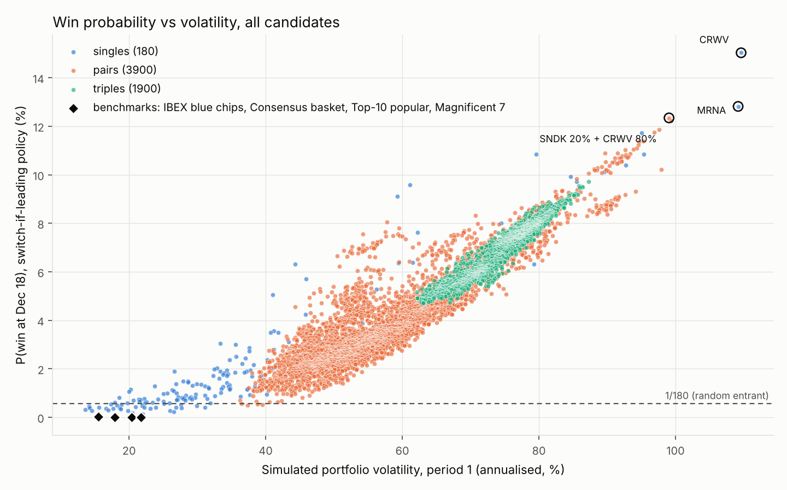
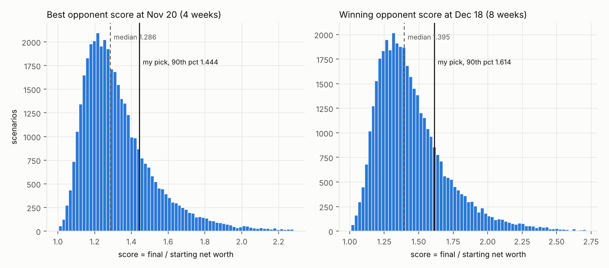

# Stock contest - period 1 submission (Oct 25, prices 2026-10-23)

Objective: maximise the probability of finishing **first** of 180 (not expected return). Ranking metric: `p_win_8w_switch` = P(win at Dec 18) if I hold this portfolio through period 1 and, on Nov 22, switch to the consensus basket only when I am leading, otherwise keep it.

## Submission (do not trade - enter these in the contest platform)

**CRWV** - P(win Dec 18) 15.35%, P(lead Nov 20) 14.74%, P(top 5 Nov 20) 30.1% (validated on 40,000 fresh scenarios).

| ticker | name | shares | price_local | currency | price_eur | value_eur | weight | last_close |
|---|---|---|---|---|---|---|---|---|
| CRWV | CoreWeave, Inc. Class A Common Stock | 206 | 54.24 | USD | 48.45 | 9,980.31 | 99.8% | 2026-10-23 |

Invested 9,980.31 EUR, cash left 19.69 EUR (earns nothing). EUR/USD used: 1.1194.

## Top 10 (re-scored on fresh scenarios)

| # | portfolio | P(win) Dec18 | P(win) hold 8w | P(lead) Nov20 | P(top5) Nov20 | median 4w | p10 / p90 4w | vol | corr cons. | co-holders | shadowed | flags |
|---|---|---|---|---|---|---|---|---|---|---|---|---|
| 1 | CRWV | 15.35% | 14.48% | 14.74% | 30.1% | -2.6% | -34.5% / 44.4% | 110% | 0.30 | 11.3 | 27% | CRWV: E1 2026-11-12? |
| 2 | MRNA | 13.24% | 12.59% | 13.11% | 27.1% | -4.1% | -34.0% / 41.2% | 109% | 0.14 | 14.7 | 34% | MRNA: E1 2026-11-06 |
| 3 | SNDK 20% + CRWV 80% | 12.55% | 12.01% | 11.52% | 28.8% | -1.9% | -31.1% / 40.5% | 99% | 0.31 | 7.3 | 38% | SNDK: E1 2026-10-30 | CRWV: E1 2026-11-12? |
| 4 | MPWR 20% + CRWV 80% | 12.46% | 11.88% | 11.50% | 28.6% | -2.2% | -31.4% / 40.4% | 100% | 0.31 | 5.5 | 25% | MPWR: E1 2026-10-30 | CRWV: E1 2026-11-12? |
| 5 | ALAB | 12.14% | 11.72% | 12.39% | 26.8% | -1.8% | -30.7% / 36.7% | 96% | 0.36 | 4.2 | 10% | ALAB: E1 2026-11-04 |
| 6 | LITE 20% + CRWV 80% | 12.01% | 11.48% | 11.10% | 28.2% | -2.1% | -31.0% / 39.3% | 98% | 0.33 | 6.8 | 31% | LITE: E1 2026-11-06 | CRWV: E1 2026-11-12? |
| 7 | NBIS 20% + CRWV 80% | 11.92% | 11.35% | 10.99% | 28.2% | -1.8% | -30.8% / 39.1% | 97% | 0.35 | 9.7 | 39% | NBIS: E1 2026-11-10 | CRWV: E1 2026-11-12? |
| 8 | MU 20% + CRWV 80% | 11.51% | 10.99% | 10.61% | 28.0% | -1.9% | -30.2% / 38.8% | 95% | 0.34 | 10.6 | 31% | MU: E2 2026-12-17? (50%; else outside 2026-12-24) | CRWV: E1 2026-11-12? |
| 9 | STX 20% + CRWV 80% | 11.39% | 10.96% | 10.64% | 27.9% | -1.8% | -30.0% / 38.4% | 95% | 0.34 | 5.9 | 26% | STX: E1 2026-10-28 | CRWV: E1 2026-11-12? |
| 10 | ALAB 20% + CRWV 80% | 11.39% | 11.01% | 10.72% | 27.9% | -1.8% | -30.0% / 38.2% | 95% | 0.35 | 7.5 | 33% | ALAB: E1 2026-11-04 | CRWV: E1 2026-11-12? |

P(win) Dec18 = switch-if-leading policy; hold 8w = no rebalance; P(lead) Nov20 = rank 1 after period 1. co-holders = avg. number of opponents holding my best-performing name; shadowed = when that name is a top-3 performer, share of scenarios where an opponent holds it at least as heavily as I do. Flags: E1/E2 earnings reaction day in period 1/2 (`?` = date not confirmed by a second source), D1/D2 ex-dividend drop (`~` = estimated).

Benchmarks for scale: IBEX blue chips (EW) 0.03%; Magnificent 7 (EW) 0.01%; Top-10 popular (EW) 0.00%; Consensus basket 0.00%. A random entrant has 0.56%.

## Sensitivity to the field mixture

P(win Dec 18) and rank within the shortlist when the share of all-in opponents changes (diversified : moderate kept at 60 : 25). Sorted by worst rank; **robust** = top 10 under every mixture. The vol-model column re-scores the same portfolios with the other US-vol choice (base mixture) as a model-risk check; it does not enter the worst rank.

| portfolio | all-in 5% | all-in 15% | all-in 30% | vol model: realised vol only | worst rank | robust |
|---|---|---|---|---|---|---|
| CRWV | 22.42% (#1) | 15.35% (#1) | 10.34% (#1) | 14.07% (#1) | 1 | **yes** |
| MRNA | 19.87% (#4) | 13.24% (#2) | 8.82% (#2) | 13.95% (#2) | 4 | **yes** |
| SNDK 20% + CRWV 80% | 20.18% (#2) | 12.55% (#3) | 7.47% (#5) | 11.47% (#4) | 5 | **yes** |
| MPWR 20% + CRWV 80% | 19.95% (#3) | 12.46% (#4) | 7.38% (#6) | 11.36% (#5) | 6 | **yes** |
| LITE 20% + CRWV 80% | 19.39% (#6) | 12.01% (#6) | 7.04% (#9) | 10.91% (#9) | 9 | **yes** |
| NBIS 20% + CRWV 80% | 19.50% (#5) | 11.92% (#7) | 7.04% (#9) | 10.72% (#10) | 9 | **yes** |
| MU 20% + CRWV 80% | 19.13% (#7) | 11.51% (#8) | 6.74% (#11) | 10.54% (#11) | 11 |  |
| STX 20% + CRWV 80% | 18.84% (#9) | 11.39% (#9) | 6.62% (#12) | 10.40% (#13) | 12 |  |
| ALAB | 18.46% (#13) | 12.14% (#5) | 8.16% (#3) | 11.72% (#3) | 13 |  |
| ALAB 20% + CRWV 80% | 18.85% (#8) | 11.39% (#10) | 6.60% (#13) | 10.46% (#12) | 13 |  |
| ARM 20% + CRWV 80% | 18.62% (#11) | 11.30% (#12) | 6.51% (#14) | 10.28% (#15) | 14 |  |
| AMAT 20% + CRWV 80% | 18.52% (#12) | 11.26% (#13) | 6.44% (#15) | 10.29% (#14) | 15 |  |
| LRCX 20% + CRWV 80% | 18.44% (#14) | 11.00% (#18) | 6.32% (#18) | 10.08% (#19) | 18 |  |
| PANW 20% + CRWV 80% | 18.34% (#18) | 11.05% (#17) | 6.30% (#19) | 10.04% (#20) | 19 |  |
| MRVL 20% + CRWV 80% | 18.39% (#15) | 10.96% (#19) | 6.33% (#16) | 10.02% (#21) | 19 |  |

Crowding check (popularity is the softest assumption): P(win Dec 18) when one lead name is three times as popular with the field as assumed.

| portfolio | base | CRWV popularity x3 | MRNA popularity x3 | ALAB popularity x3 |
|---|---|---|---|---|
| CRWV | 15.35% | 11.63% | 14.76% | 14.79% |
| MRNA | 13.24% | 13.01% | 9.47% | 13.26% |
| SNDK 20% + CRWV 80% | 12.55% | 8.08% | 12.14% | 12.12% |
| MPWR 20% + CRWV 80% | 12.46% | 7.76% | 12.01% | 11.99% |
| ALAB | 12.14% | 11.24% | 11.54% | 10.93% |
| LITE 20% + CRWV 80% | 12.01% | 7.61% | 11.63% | 11.53% |
| NBIS 20% + CRWV 80% | 11.92% | 7.90% | 11.65% | 11.58% |
| MU 20% + CRWV 80% | 11.51% | 7.21% | 11.28% | 11.22% |

## What it takes to win

Best opponent after 4 weeks: median score 1.286 (10-90%: 1.132-1.600). Winning score at Dec 18: median 1.395 (10-90%: 1.181-1.804).

## Earnings and ex-dividend flags

Names in the top 10:

| ticker | name | last reported | next earnings | timing | reaction day | period | status | hist. |move| | ex-div P1 | ex-div P2 |
|---|---|---|---|---|---|---|---|---|---|---|
| CRWV | CoreWeave, Inc. Class A Common Stock | 2026-08-11 | 2026-11-11 | AMC | 2026-11-12 | P1 | sources differ, same window | 15.7% |  |  |
| MRNA | Moderna, Inc. Common Stock | 2026-07-31 | 2026-11-06 | BMO | 2026-11-06 | P1 | confirmed (2 sources) | 7.2% |  |  |
| SNDK | Sandisk Corporation Common Stock | 2026-08-05 | 2026-10-29 | AMC | 2026-10-30 | P1 | confirmed (2 sources) | 7.4% |  |  |
| MPWR | Monolithic Power Systems, Inc. Common Stock | 2026-07-30 | 2026-10-29 | AMC | 2026-10-30 | P1 | confirmed (2 sources) | 8.3% |  |  |
| ALAB | Astera Labs, Inc. Common Stock | 2026-08-04 | 2026-11-03 | AMC | 2026-11-04 | P1 | confirmed (2 sources) | 13.4% |  |  |
| LITE | Lumentum Holdings Inc. Common Stock | 2026-08-11 | 2026-11-05 | AMC | 2026-11-06 | P1 | confirmed (2 sources) | 9.7% |  |  |
| NBIS | Nebius Group N.V. Class A Ordinary Shares | 2026-08-12 | 2026-11-10 | BMO | 2026-11-10 | P1 | confirmed (2 sources) | 10.9% |  |  |
| MU | Micron Technology, Inc. Common Stock | 2026-09-30 | 2026-12-16 | AMC | 2026-12-17 | P2 | unconfirmed (manual check) | 8.2% |  |  |
| STX | Seagate Technology Holdings PLC Ordinary Shares (Ireland) | 2026-07-28 | 2026-10-27 | AMC | 2026-10-28 | P1 | confirmed (2 sources) | 7.0% |  |  |

Consensus names:

| ticker | name | last reported | next earnings | timing | reaction day | period | status | hist. |move| | ex-div P1 | ex-div P2 |
|---|---|---|---|---|---|---|---|---|---|---|
| BBVA.MC | BBVA | 2026-07-30 | 2026-10-29 | DMH | 2026-10-29 | P1 | yahoo-confirmed | 3.5% | 2026-11-04 (-1.44%, est: same window last year) |  |
| CABK.MC | CaixaBank | 2026-07-29 | 2026-10-30 | DMH | 2026-10-30 | P1 | yahoo-confirmed | 2.7% | 2026-11-04 (-1.50%, est: same window last year) |  |
| IAG.MC | International Airlines Group | 2026-07-31 | 2026-11-06 | DMH | 2026-11-06 | P1 | yahoo-confirmed | 4.1% |  | 2026-11-26 (-1.02%, est: same window last year) |
| IBE.MC | Iberdrola | 2026-10-21 |  |  |  | - | none | 1.5% |  |  |
| IDR.MC | Indra | 2026-07-23 | 2026-10-29 | DMH | 2026-10-29 | P1 | yahoo-confirmed | 3.1% |  |  |
| ITX.MC | Inditex | 2026-09-09 | 2026-12-02 | DMH | 2026-12-02 | P2 | yahoo-confirmed | 3.5% | 2026-10-29 (-1.54%, yahoo) |  |
| REP.MC | Repsol | 2026-07-23 | 2026-10-29 | DMH | 2026-10-29 | P1 | yahoo-confirmed | 2.5% |  |  |
| SAN.MC | Santander | 2026-07-22 | 2026-10-28 | DMH | 2026-10-28 | P1 | yahoo-confirmed | 3.2% | 2026-10-29 (-1.09%, yahoo) |  |
| TEF.MC | Telefónica | 2026-07-29 | 2026-11-12 | DMH | 2026-11-12 | P1 | yahoo-confirmed | 2.5% |  | 2026-12-15 (-4.39%, est: same window last year) |
| ASML.AS | ASML Holding | 2026-10-14 |  |  |  | - | none | 6.4% | 2026-10-26 (-0.13%, yahoo) |  |
| RACE.MI | Ferrari | 2026-07-30 | 2026-11-03 | BMO | 2026-11-03 | P1 | yahoo-confirmed | 5.7% |  |  |
| MC.PA | LVMH Moët Hennessy Louis Vuitton |  |  |  |  | - | none |  |  | 2026-12-01 (-1.96%, yahoo) |
| RHM.DE | Rheinmetall | 2026-08-06 | 2026-11-05 | DMH | 2026-11-05 | P1 | yahoo-confirmed | 4.9% |  |  |
| AAPL | Apple Inc. Common Stock | 2026-07-30 | 2026-11-02 | AMC | 2026-11-03 | P1 | confirmed (2 sources) | 2.4% | 2026-11-09 (-0.08%, est: quarterly cadence) |  |
| MSFT | Microsoft Corporation Common Stock | 2026-07-29 | 2026-10-28 | AMC | 2026-10-29 | P1 | confirmed (2 sources) | 5.4% | 2026-11-19 (-0.19%, nasdaq) |  |
| AMZN | Amazon.com, Inc. Common Stock | 2026-07-30 | 2026-10-29 | AMC | 2026-10-30 | P1 | confirmed (2 sources) | 5.5% |  |  |
| MSTR | Strategy Inc Common Stock Class A | 2026-07-30 | 2026-10-29 | AMC | 2026-10-30 | P1 | confirmed (2 sources) | 7.0% |  |  |
| NVDA | NVIDIA Corporation Common Stock | 2026-08-26 | 2026-11-18 | AMC | 2026-11-19 | P1 | unconfirmed (manual check) | 5.5% |  | 2026-12-10 (-0.12%, est: quarterly cadence) |
| AMD | Advanced Micro Devices, Inc. Common Stock | 2026-08-04 | 2026-11-03 | AMC | 2026-11-04 | P1 | confirmed (2 sources) | 8.2% |  |  |
| MU | Micron Technology, Inc. Common Stock | 2026-09-30 | 2026-12-16 | AMC | 2026-12-17 | P2 | unconfirmed (manual check) | 8.2% |  |  |
| NFLX | Netflix, Inc. Common Stock | 2026-10-20 | 2027-01-19 | unknown |  | - | estimate/single source | 7.6% |  |  |
| GOOGL | Alphabet Inc. Class A Common Stock | 2026-07-22 | 2026-10-28 | AMC | 2026-10-29 | P1 | confirmed (2 sources) | 5.4% |  | 2026-12-04 (-0.07%, est: quarterly cadence) |
| AVGO | Broadcom Inc. Common Stock | 2026-09-02 | 2026-12-09 | AMC | 2026-12-10 | P2 | confirmed (2 sources) | 9.2% |  |  |
| TSLA | Tesla, Inc. Common Stock | 2026-10-21 |  |  |  | - | none | 8.6% |  |  |
| META | Meta Platforms, Inc. Class A Common Stock | 2026-10-21 |  |  |  | - | none | 8.2% |  |  |
| PLTR | Palantir Technologies Inc. Class A Common Stock | 2026-08-03 | 2026-11-02 | AMC | 2026-11-03 | P1 | confirmed (2 sources) | 15.2% |  |  |
| SPCX | Space Exploration Technologies Corp. Class A Common Stock | 2026-10-20 |  |  |  | - | none | 11.1% |  |  |

64 names have an earnings date inside a period that is **not** confirmed by two independent sources (most European names: Yahoo is the only automated source; see `stock_features.csv`). Relevant ones: BBVA.MC 2026-10-29 [yahoo-confirmed], CABK.MC 2026-10-30 [yahoo-confirmed], IAG.MC 2026-11-06 [yahoo-confirmed], IDR.MC 2026-10-29 [yahoo-confirmed], ITX.MC 2026-12-02 [yahoo-confirmed], REP.MC 2026-10-29 [yahoo-confirmed], SAN.MC 2026-10-28 [yahoo-confirmed], TEF.MC 2026-11-12 [yahoo-confirmed], RACE.MI 2026-11-03 [yahoo-confirmed], RHM.DE 2026-11-05 [yahoo-confirmed], NVDA 2026-11-19 [unconfirmed (manual check)], MU 2026-12-17 [unconfirmed (manual check)], CRWV 2026-11-12 [sources differ, same window].
Checked by hand (see `data/earnings_overrides.csv`): MRNA Nov 6 8:00 ET confirmed on the company IR site; NVDA and MU not yet announced by the companies (modelled as 85% / 50% inside the window); CRWV not yet announced, both candidate dates (Nov 9 / Nov 11) fall in period 1; GRF.MC Nov 10 from Investing.com.

## Consensus basket and field model

Popularity weights (students' likely holdings; base weight 0.3 for everything else). Consensus basket = names with popularity >= 3.0, weighted by popularity:

NVDA 7.1%, AAPL 5.7%, TSLA 5.7%, AMZN 5.0%, ITX.MC 5.0%, MSFT 5.0%, SPCX 5.0%, SAN.MC 5.0%, META 4.3%, GOOGL 4.3%, PLTR 4.3%, BBVA.MC 3.6%, AMD 3.6%, IBE.MC 3.6%, ASML.AS 3.6%, IDR.MC 2.8%, REP.MC 2.8%, MC.PA 2.8%, TEF.MC 2.8%, NFLX 2.8%, RHM.DE 2.5%, CABK.MC 2.1%, IAG.MC 2.1%, RACE.MI 2.1%, MSTR 2.1%, AVGO 2.1%, MU 2.1%

Field: 179 opponents per scenario, div 60% / mod 25% / all-in 15%; diversified = 8-15 names ~ popularity, moderate = 3-5 names ~ popularity^1.5, all-in = 1-2 names ~ popularity x vol; Dirichlet weights, whole shares. On Nov 22 50% of opponents re-pick, the rest hold. Popularity is uncertain: every ~1,000 scenarios draw one true popularity vector = weights x lognormal(sigma 20%), shared by the whole field.

## Method

- 20,000 search scenarios + 40,000 validation scenarios, seed 20261025. Joint daily EUR total-return block bootstrap (5-day blocks) over the last 2 years, filtered-historical-simulation residuals rescaled to the current vol (`blend` = avg of EWMA(0.94) and 60d, ex-earnings, jumps winsorised at 4 sigma). US names: period variance moved 50% toward ATM option-implied variance for the Nov 20 expiry (= end of period 1), level-neutral (IV rescaled by the median model/IV ratio, so only the US cross-section changes).
- Drift: CAPM, rf 2% + beta to consensus x 5% ERP. Horizon 20 + 20 trading days.
- Earnings: historical reaction days are replaced by their market component; inside a window the reaction day gets a jump = (own earnings move multiple, shrunk to the pooled one) x current daily vol, random sign.
- Price-only scoring: known/estimated ex-dividend drops are subtracted in the window.
- Candidates: 5,984 (all singles, pairs of the 40 highest-vol names in 5 weightings, greedy triples, benchmarks), whole shares at the latest close. Ties split.
- The switch policy uses the realised field leader (an oracle: on Nov 22 you only have an estimate), so P(win Dec18) is slightly optimistic for every candidate alike.
