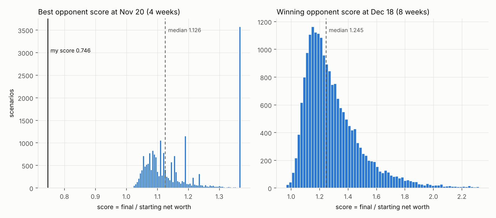

# Stock contest - period 2 rebalance (Nov 22)

Period-1 returns: realised closes 2026-10-23 -> 2026-11-20. My score after period 1: **0.7463**.

Estimated best opponent score now (random portfolios, known returns): median 1.126 (10-90%: 1.058-1.368). P(I am leading now) = 0.0%.

## Rebalance (do not trade - enter in the contest platform)

**MRVL** - P(win Dec 18) 3.28%, P(top 5) 8.5%.

Shares below are sized on 10,000 EUR; scale by your actual net worth (7,463 EUR): shares = floor(net worth x weight / EUR price).

| ticker | name | shares | price_local | currency | price_eur | weight |
|---|---|---|---|---|---|---|
| MRVL | Marvell Technology, Inc. Common Stock | 89 | 122.279999 | USD | 111.47048329401296 | 99.2% |

## Top 10

| # | portfolio | P(win) | P(top5) | vol | corr cons. | median | p90 |
|---|---|---|---|---|---|---|---|
| 1 | MRVL | 3.28% | 8.5% | 117% | 0.35 | -4.1% | 45.3% |
| 2 | ASML.AS 20% + MRVL 80% | 2.51% | 6.8% | 106% | 0.38 | -3.4% | 40.8% |
| 3 | NBIS | 2.36% | 7.0% | 112% | 0.53 | -4.3% | 43.4% |
| 4 | MRVL 80% + MU 20% | 2.16% | 6.3% | 105% | 0.42 | -3.1% | 40.4% |
| 5 | CRWV | 2.14% | 7.0% | 111% | 0.50 | -2.9% | 43.9% |
| 6 | MRVL 80% + LITE 20% | 2.14% | 6.4% | 104% | 0.41 | -3.1% | 40.1% |
| 7 | MRVL 80% + ARM 20% | 2.10% | 6.2% | 103% | 0.42 | -3.1% | 40.4% |
| 8 | MRVL 80% + ALAB 20% | 2.08% | 6.2% | 104% | 0.43 | -3.1% | 40.3% |
| 9 | MRVL 80% + TER 20% | 2.04% | 6.0% | 101% | 0.41 | -3.1% | 39.2% |
| 10 | AMAT 20% + MRVL 80% | 2.02% | 5.9% | 101% | 0.41 | -2.9% | 39.2% |

## Rule of thumb test: de-risk when ahead, concentrate when behind

| my_score_after_p1 | scenario | p_leading_now | best | p_win_best | best_concentrated | p_win_concentrated | best_consensus_like | p_win_consensus_like | best_low_vol | p_win_low_vol | p_win_consensus_basket | rule_says | model_says |
|---|---|---|---|---|---|---|---|---|---|---|---|---|---|
| 0.7463 | actual | 0.00% | MRVL | 3.28% | MRVL | 3.28% | Consensus basket | 0.00% | BKT.MC | 0.00% | 0.00% | concentrate | concentrate |
| 1.0578744367325432 | field-max q10 | 10.00% | MRVL | 23.15% | MRVL | 23.15% | Magnificent 7 (EW) | 1.98% | ABI.BR | 8.79% | 0.63% | concentrate | concentrate |
| 1.125751751736631 | field-max q50 | 50.00% | CRWV | 29.80% | CRWV | 29.80% | Magnificent 7 (EW) | 13.93% | ABI.BR | 21.87% | 11.03% | concentrate | concentrate |
| 1.3679922044475927 | field-max q90 | 82.12% | Consensus basket | 75.67% | SNPS 80% + SPCX 20% | 66.80% | Consensus basket | 75.67% | Consensus basket | 75.67% | 75.67% | de-risk | de-risk |
| 1.1820393393234625 | field-max q50 +5% | 65.71% | STX | 37.21% | STX | 37.21% | Top-10 popular (EW) | 31.11% | ABI.BR | 35.10% | 29.82% | de-risk | concentrate |

Concentrated = 1-2 names with vol >= 60%; consensus-like = correlation to the consensus >= 0.8; low vol = portfolio vol <= 25%. `rule_says` applies the rule (de-risk if my score is above the median estimated field max); `model_says` is what the simulation prefers. Where they disagree, follow the simulation.

